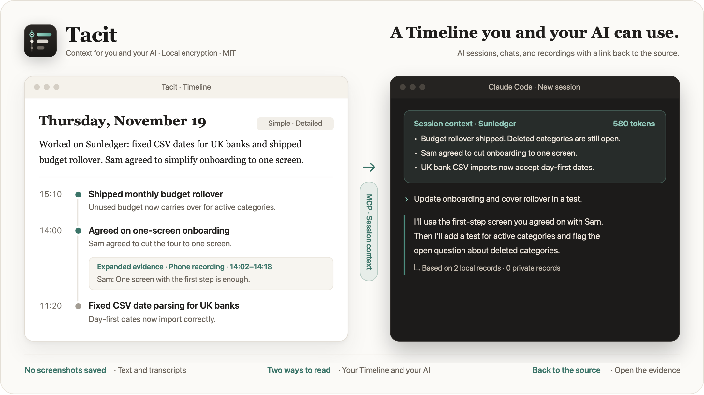
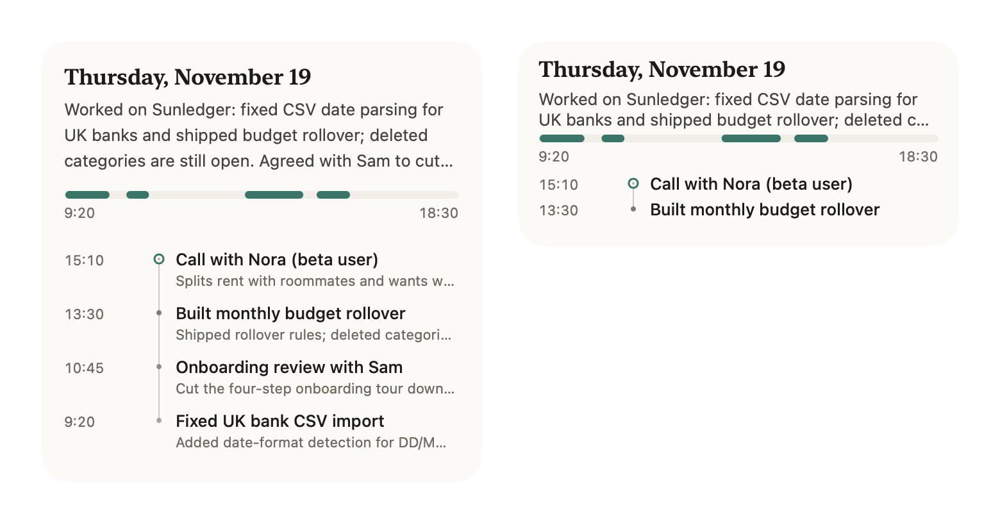
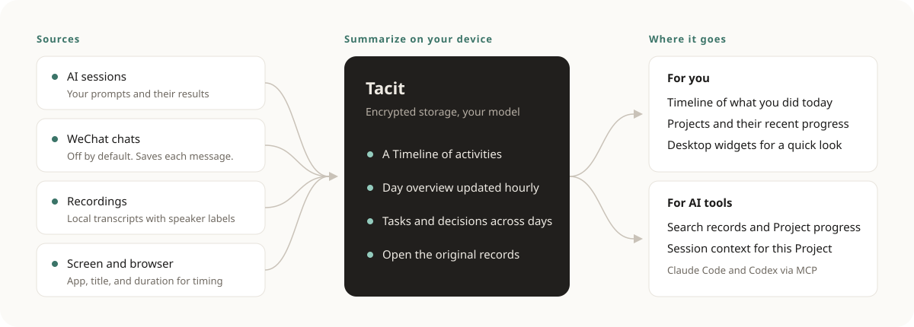

<p align="center">
  <picture>
    <source media="(prefers-color-scheme: dark)" srcset="assets/readme/hero-en-dark.png">
    
  </picture>
</p>

<p align="center">
  <b>Tacit turns activity and conversations across your devices into a Timeline you can revisit and your AI tools can search through MCP.</b>
</p>

<p align="center">
  <a href="https://github.com/JinSooo/tacit/releases"></a>
  
  
  <a href="LICENSE"></a>
</p>

<p align="center">
  <a href="https://tacit.jinso.top/en/">Website</a> ·
  <a href="#get-started">Get started</a> ·
  <a href="#what-tacit-does">Features</a> ·
  <a href="#connect-ai-tools">Connect AI tools</a> ·
  <a href="#data-and-privacy">Data and privacy</a> ·
  <a href="#common-questions">Common questions</a> ·
  <a href="#development">Development</a>
</p>

<p align="center">
  <b>English</b> · <a href="README.zh-CN.md">简体中文</a>
</p>

---

Starting a new AI session often means explaining where a Project stands, what you decided last time, and what's still open. Tacit records AI sessions, WeChat chats, and conversations in the background. It summarizes what happened and what you decided, then lets Claude Code and Codex read that context directly. Away from your Mac, the Android app can record and transcribe conversations on the phone, sync with end-to-end encryption, and show the Timeline. You can open the records behind each summary.

<p align="center">
  <picture>
    <source media="(prefers-color-scheme: dark)" srcset="assets/readme/widget-en-dark.png">
    
  </picture>
  <br>
  <sub>Desktop widgets with sample data. Click a widget to open that day's Timeline.</sub>
</p>

## What Tacit does

### A Timeline for each day

New records appear as draft activities with a start time, a short description, and source icons. Tacit can summarize an activity after 30 minutes of quiet. The Day overview is two to four sentences and updates hourly by default. Opening today's Timeline can also queue an update. Expand an Activity to read its original records in place, or switch from Simple to Detailed for a full day of records grouped by source.

### Where a Project stands

The Project page starts with a one-sentence overview. Tasks under In progress show what happened and list Open questions. Expand a Task to read its Task history across days. Recent progress is grouped by date. You can correct anything Tacit got wrong under What AI remembers.

### Pick up where you left off with AI

Claude Code and Codex get Session context about the current Project's active Tasks when a new session starts. AI tools can also look up what you did yesterday, what you decided, or which conversation a conclusion came from.

### Find something you saw

Search Screen text and browser records. Filter by date, source, or device and open the original text from the result.

### Meetings and chats

Mac and Android transcribe recordings on the device by default. Tacit groups recordings by conversation, cleans up filler words in the transcript, and uses speaker labels such as Me and Speaker N. WeChat capture is off by default. Once enabled, it saves chats as individual messages.

### Record and read on Android

Record in-person conversations away from your computer. Recordings are encrypted on the phone, and transcripts sync to the Mac through an end-to-end encrypted connection over the local network or a Relay mailbox. Pair with View permission to read the full Timeline, or use the phone on its own with optional AI summaries for individual conversations.

### Desktop widgets

Medium and large widgets on Mac show recent activities at a glance.

### English and Chinese

Both the interface and generated summaries support English and Simplified Chinese. Fresh installs follow your system language, and existing installs keep Chinese on upgrade. Switch on Mac in **Settings › General**, or on Android through system per-app language settings.

## How it works

<p align="center">
  
</p>

What you say and write carries the most weight, followed by what others say to you. AI sessions, chats, and recordings supply the material for summaries. Screen and browser records give the Timeline its timing through app names, titles, and durations. Their text is available in Search.

Tacit uses screenshots in memory to extract searchable text and discards the images. The database is encrypted and stored on the device running the Background service.

## Get started

### Mac

Tacit requires an Apple silicon Mac running macOS 14 or later.

1. Download `Tacit-<version>.dmg` from the latest `Tacit v<version> - Mac` entry in [Releases](https://github.com/JinSooo/tacit/releases). Open the disk image and drag Tacit to Applications.
2. Open Tacit from Applications. macOS may block the first launch because the app is signed with a self-signed certificate and has no Apple notarization. Click **Done**, go to **System Settings › Privacy & Security**, then click **Open Anyway** next to Tacit and enter your password. If the button is missing, run `xattr -dr com.apple.quarantine /Applications/Tacit.app` in Terminal, then open Tacit again.
3. The main window opens and the Background service sets itself up. Tacit keeps recording in the menu bar after you close the window. Open Tacit from Applications again to bring the window back.

The Setup checklist at the top of the Timeline shows what's left to do.

- Grant the permissions you need under **Settings › Sources**.
- Choose a Summary model in **Settings › AI models** and test the connection. Tacit uses your local Claude Code sign-in by default. You can select Codex or enter API settings.
- Choose what to record under **Settings › Sources**. Enabling recording for the first time downloads about 270 MB of speech models.
- Connect Claude Code or Codex under **Settings › AI tools**. Save a key backup under **Maintenance › Key backup**.

See the [trial guide](docs/trial-guide.md) for a first-run walkthrough or [troubleshooting](docs/troubleshooting.md) if Tacit has trouble opening, recording, or transcribing.

To add a desktop widget, right-click the desktop, choose **Edit Widgets**, and search for Tacit.

### Android

Tacit requires an arm64 phone running Android 9 or later.

1. Download `Tacit-<version>.apk` from the latest `Tacit v<version> - Android` entry in [Releases](https://github.com/JinSooo/tacit/releases) and install it.
2. On first launch, enable recording and grant microphone access. Download the speech models in **Settings › Transcription**, then listen to a sample and confirm your voice once.
3. **With a Mac.** Create an invite QR code in **Settings › Devices** on the Mac. Scan it under **Settings › Connect to Mac** on the phone. With View permission, the phone can sync transcripts and display the full Timeline. A Relay mailbox can carry encrypted updates while you're away.
4. **On its own.** Recordings and transcripts stay in encrypted storage on the phone. You can configure an OpenAI-compatible endpoint under **Settings › AI summaries** to summarize individual conversations. See [Tacit for Android](android/README.md).

<details>
<summary><b>Run the Background service on a server with Docker</b></summary>

The Mac app runs its Background service locally by default. If you want it to run on a Linux server or a Windows PC with Docker, use the public `ghcr.io/jinsooo/tacit-hub` image for `linux/amd64` or `linux/arm64`. After starting the container, generate an admin Invite link on the server and paste it under **Settings › Background & connection › Connect to a remote service** on the Mac. See the [server deployment guide](docs/server-deployment.md).

</details>

> [!NOTE]
> Tacit checks for work every 15 minutes. Model calls count toward your API or account usage. In **Settings › AI models**, you can change when activities and the Day overview update, and set a daily token limit. At the limit, Tacit pauses summary calls until the next day. Draft activities still appear.

## Connect AI tools

| Tool | Search records | Project context in new sessions |
| --- | --- | --- |
| Claude Code | Yes | Yes |
| Codex | Yes | Yes |
| Other MCP-compatible AI tools | Yes | No |

Connect Claude Code and Codex in Settings. Other AI tools can connect to the standard MCP interface to search or append records.

For example, you can ask:

```text
What was I working on yesterday afternoon?
What did we decide on this project last time, and what's still open?
Save the decision from this conversation to my records.
```

Tacit logs each read. An AI tool can append a record only when you ask it to, and Tacit screens the text for secrets before saving. Existing records stay intact.

Choose your Summary model separately from the AI tools you connect. Tacit supports Anthropic, OpenAI-compatible APIs, custom endpoints, and the Claude Code or Codex CLI signed in on your Mac.

## Data and privacy

> [!IMPORTANT]
> When you choose a cloud model, Tacit sends the text needed for the summary to that provider. Records retrieved by an AI tool become part of that tool's session. Tacit collects no telemetry and offers no hosted Background service.

- **Encrypted storage.** The database, original audio, and outgoing records are encrypted at rest. macOS Keychain or Android Keystore protects the keys. Keep a key backup. Losing the keys makes the data unreadable.
- **Screenshots and audio.** Tacit discards screenshots after extracting text in memory. You can change the default seven-day audio retention period. Transcripts, Tasks, and the Timeline are kept separately.
- **Recording.** Transcription runs on the device by default. Tacit transcribes conversations that contain your voice, with an exception for meetings on Mac. Follow local recording laws and tell people before recording.
- **Private records.** Tacit excludes `private` records from summaries and Session context by default. AI tools can still retrieve them through a direct query.
- **Secret filtering.** Tacit blocks known key and token formats before writing records. Some secret formats may go undetected.
- **Update checks.** The Mac app reads the website's `latest.json` once a day and shows Update available on the Timeline when a new version is available. The request contains no cookies or device details. The website host can see the source IP address.

<details>
<summary>Capture filters and other details</summary>

- Screen capture skips Apple Passwords, Keychain Access, 1Password, Bitwarden, LastPass, Dashlane, and Proton Pass.
- Tacit detects private browser windows by title. Some browsers or languages may be missed. Pause recording before handling sensitive material.
- App exclusions are built in. Custom exclusions are currently unavailable.
- In local mode, management, Web view, and MCP listen on localhost. Pairing a device opens a separate encrypted device port.
- Manage Collect, View, and Admin permissions under **Settings › Devices**. Phones start with View and can switch between View and Collect. AI tools use restricted credentials for reading and appending. Large batches of remote deletions must be done on the Mac.
- Set a self-hosted [Relay mailbox](relay/README.md) in **Settings › Background & connection › Relay mailbox** to sync when your phone is on a different network or your Mac is asleep. The mailbox can see message times and sizes. Message content stays end-to-end encrypted.
- Installation of third-party Sources is currently unavailable from Settings. The plugin design limits access to approved paths, blocks network access, writes, and subprocesses, and requires a working sandbox.
- Data is stored in `~/Library/Application Support/record-anything/`, outside the checkout. Keep record text, keys, audio, and other people's private material out of GitHub issues.

</details>

## Common questions

<details>
<summary><b>Can I replay my screen?</b></summary>

Tacit discards screenshots and keeps searchable text. For a summary of what you did and decided, open an Activity to read the AI session, chat, or conversation it was based on. Screen records supply app names, titles, and timing.

</details>

<details>
<summary><b>Why does macOS block the first launch?</b></summary>

Tacit is signed with a consistent self-signed certificate and has no Apple notarization. Once you allow it to open, upgrades signed with the same certificate retain the system permissions you granted.

</details>

<details>
<summary><b>Can I use my own model endpoint?</b></summary>

For summaries, choose any OpenAI-compatible endpoint, including a self-hosted one. You can also use your Mac's existing Claude Code or Codex sign-in. Transcription runs on the device by default.

</details>

<details>
<summary><b>Which devices are supported?</b></summary>

There are installers for Apple silicon Macs running macOS 14 or later and [arm64 Android phones](android/README.md) running Android 9 or later. A Windows client is planned. For now, Windows can host the Background service through Docker. Intel Macs are unsupported and iOS is still being explored.

</details>

<details>
<summary><b>Can AI tools change my records?</b></summary>

AI tools have read and append access. You can correct a mistake in a Project or Task. Your corrections take precedence over what the model inferred.

</details>

## Current limitations

- Capture accuracy and all-day resource use are still being improved. Summaries may miss details or misread what happened. Open the records behind important conclusions to check them.
- Third-party plugin installation and the dedicated local model controls are currently unavailable.
- File access permissions, including Safari history, and the first-launch approval flow need further verification on fresh Macs with System Integrity Protection enabled.
- The Android client is released separately as an arm64 APK. The Background service also has an optional [standalone Docker deployment](docs/server-deployment.md).

## Update or uninstall

**Update.** The Mac Timeline shows Update available when there's a new version. Download the new DMG, quit Tacit from the menu bar's right-click menu, and replace the app in Applications. On Android, install the new APK over the existing app. Upgrades retain data, settings, permissions, paired devices, and AI tool connections.

**Uninstall.** Run the following command in Terminal. It asks whether to delete your data as well.

```sh
sh /Applications/Tacit.app/Contents/Resources/uninstall.sh
```

## Development

| Directory | Contents |
| --- | --- |
| `collector/` | Swift and SwiftUI menu bar app, capture, recording, on-device transcription, and widgets |
| [`hub/`](hub/README.md) | Bun Background service, encrypted database, summary jobs, and MCP |
| [`android/`](android/README.md) | Kotlin client for recording, transcription, optional conversation summaries, HPKE sync, and Timeline viewing |
| [`relay/`](relay/README.md) | Relay mailbox for Cloudflare Workers or Docker |
| [`web/`](web/README.md) | Web view for service status |
| [`site/`](site/README.md) | Static [website](https://tacit.jinso.top/en/) with no dependencies |
| `packages/`, `plugins/`, `schema/` | Shared record types, built-in Sources, and cross-platform fixtures |

<details>
<summary>Install from source</summary>

Install full Xcode with Swift 6 or later and `actool`, plus [Bun](https://bun.sh). Open Xcode once to install its components. Building app resources requires full Xcode.

```sh
git clone https://github.com/JinSooo/tacit.git
cd tacit
bun install --frozen-lockfile
./install.sh
```

`./install.sh` builds, signs, and installs Tacit in Applications, then runs the same setup as the packaged app. Run it again to upgrade. Use `./uninstall.sh` to uninstall.

</details>

<details>
<summary>Run tests</summary>

Run these commands from the repository root.

```sh
bun test
bun x tsc --noEmit
bun x vite build --config web/vite.config.ts
bun scripts/check-i18n-docs.ts --strict

# The Swift tests require the local audio library prepared by the installer.
python3 scripts/guarded-run.py --memory-mb 8192 --seconds 900 -- collector/swift.sh test -j 2
./scripts/export-icons.sh --check
```

Tests use synthetic records and temporary data directories. `./install.sh` changes the local app installation and Background service.

</details>

- [Installation and releases](docs/installation.md)
- [Source plugins](docs/plugins.md)
- Chinese reference docs for [design](docs/design.md), [API contracts](docs/contracts.md), [UI](docs/ui.md), and [performance sampling](scripts/performance-sampling.md)

## License

Tacit is available under the [MIT License](LICENSE). Third-party dependencies, fonts, and downloaded models have their own licenses. See the [bundled Phosphor license](collector/Resources/Phosphor/LICENSE).
