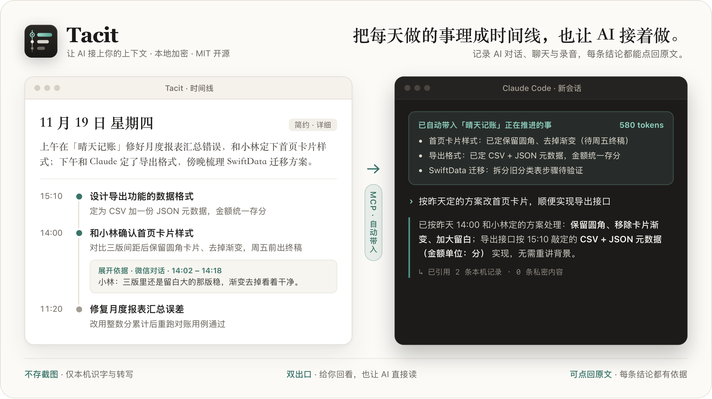
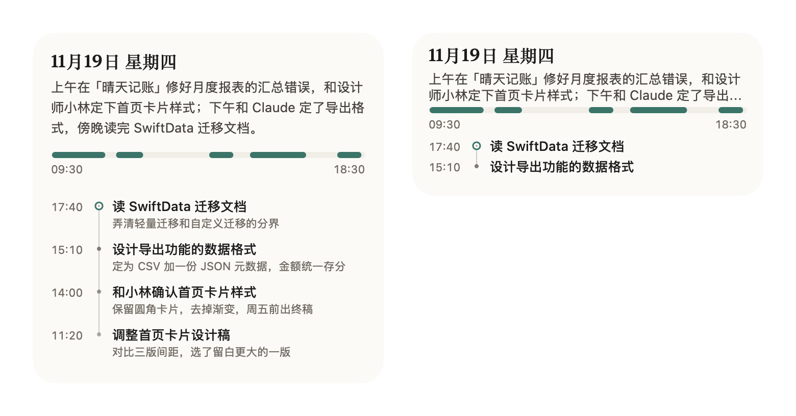
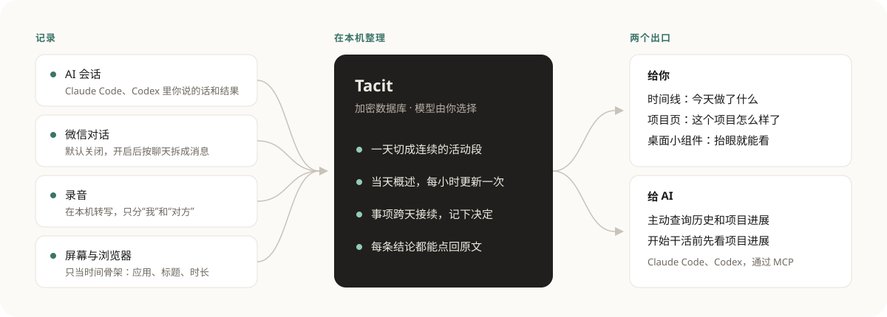

<p align="center">
  <picture>
    <source media="(prefers-color-scheme: dark)" srcset="assets/readme/hero-dark.png">
    
  </picture>
</p>

<p align="center">
  <b>跨设备把每天的活动与对话整理成一条时间线，给你回看，也通过 MCP 让任意 AI 工具不用重讲背景直接接着用。</b>
</p>

<p align="center">
  <a href="https://github.com/JinSooo/tacit/releases"></a>
  
  
  <a href="LICENSE"></a>
</p>

<p align="center">
  <a href="https://tacit.jinso.top">官网</a> ·
  <a href="#开始使用">开始使用</a> ·
  <a href="#它能做什么">功能</a> ·
  <a href="#连接-ai">连接 AI</a> ·
  <a href="#数据与隐私">数据与隐私</a> ·
  <a href="#常见问题">常见问题</a> ·
  <a href="#开发">开发</a>
</p>

---

每开一个新的 AI 会话，都要把背景重新讲一遍：这个项目做到哪了、上次定了什么、还卡在哪。Tacit 在后台记下你和 AI 的对话、微信聊天和录音，在本机整理成每天发生的事和你做的决定，再让 Claude Code、Codex 直接来读。离开电脑时，Android 端同样可以在本地录音转写，端到端加密同步到 Mac 并在手机上回看时间线，每条结论都能点回原文。

<p align="center">
  <picture>
    <source media="(prefers-color-scheme: dark)" srcset="assets/readme/widget-dark.png">
    
  </picture>
  <br>
  <sub>桌面小组件（示例数据）：当天概述、今天的活动条和最近几段，点一下打开当天时间线。</sub>
</p>

## 它能做什么

**📅 一天一条时间线**
记录入库后实时生成草稿段，每段连续的活动一行：几点开始、做了什么、用了哪些应用；活动安静满 30 分钟后由模型润色。顶部是 2–4 句的当天概述，每小时更新一次，打开时间线时还会按需补一次。点开一段，原地展开它的原始记录。想看细节就切到详细档，按来源分泳道，看全天每条记录。

**📁 项目现在怎么样了**
项目页上面是一句话概况，接着是正在推进的几件事，每件写明进展和还没定的事，点开就能读这件事跨天的经过。再往下按天列出这个项目最近的进展。AI 记错了的地方，可以在这里改正。

**🤖 让 AI 接着做**
Claude Code、Codex 新开会话时，自动带入当前项目正在推进的事。AI 也能主动查询：昨天下午在做什么、上次定了什么、这条结论出自哪段对话。

**🔍 找回看过的东西**
屏幕和浏览器上的文字都能搜到，可以按日期、来源或设备筛选，搜到的结果直接展开原文。

**🎙️ 会议与聊天**
录音在 Mac 和 Android 本机转写，按场整理出总结和去掉口头禅的原文，只分“我”和“对方”。微信对话默认关闭，开启后按聊天拆成消息。

**📱 Android 随身记录与查看**
离开电脑时的当面交谈与会议由 Android 端在本地加密录音转写，支持局域网或中转信箱端到端加密同步到 Mac；配对后可在手机上直接回看全天时间线，也可以独立使用并可选开启手机端单场 AI 总结。

**🪟 桌面小组件**
Mac 提供中号和大号两种小组件，抬眼就能看到今天做了哪些事。

## 工作方式

<p align="center">
  
</p>

不同来源的权重不一样，按离你本人的意图远近排：你说的、写的最重要，别人对你说的其次，你看过的最低。所以 AI 会话、聊天和录音是整理的主体，屏幕和浏览器只提供时间骨架（应用、标题、时长），上面的文字可以搜，但不参与整理。

截图只在内存里给识字用，从不保存。数据库加密存在本机。

## 开始使用

### Mac 端

需要 Apple 芯片的 Mac，系统 macOS 14 或更新。

1. 从 [Releases](https://github.com/JinSooo/tacit/releases) 里最新的“Tacit v<版本号> - Mac”下载 `Tacit-<版本号>.dmg`，打开后把 Tacit 拖进“应用程序”。
2. 从“应用程序”打开 Tacit。安装包没有经过 Apple 公证，第一次打开会被系统拦下：点“完成”，打开 **系统设置 › 隐私与安全性**，在页面下方的 Tacit 旁边点 **仍要打开**，输入密码。如果没有这个按钮，在终端运行 `xattr -dr com.apple.quarantine /Applications/Tacit.app` 后再打开。
3. 主窗口会自己打开，后台服务也会自动准备好，不需要用命令行。之后关掉窗口，Tacit 留在菜单栏继续记录；再从“应用程序”打开一次，窗口就回来。

时间线顶部会列出还没完成的几步，做完一项就少一项：

- **系统授权**：在数据源页面授予需要的权限。
- **整理模型**：在 **设置 › AI 模型** 选择模型并测试连接。默认用本机已登录的 Claude Code，也可以改用 Codex，或者直接填 API。
- **记录来源**：在 **设置 › 数据源** 选择要记录什么。第一次开启录音时，会下载约 270MB 的本机语音模型。
- **连接 AI 工具**：在 **设置 › AI 工具** 一键连接 Claude Code、Codex，再到 **维护 › 密钥备份** 保存一份密钥备份。

遇到启动、记录或转写问题时，见[常见问题](docs/troubleshooting.md)。

想加桌面小组件：在桌面空白处右键，选“编辑小组件”，搜索 Tacit。

### Android 端

需要 arm64 手机，系统 Android 9 或更新。

1. 从 [Releases](https://github.com/JinSooo/tacit/releases) 里最新的“Tacit v<版本号> - Android”下载 `Tacit-<版本号>.apk` 并安装。
2. 首次打开点“开启”授权麦克风并开始录音；在 **设置 › 语音转写** 下载本机语音模型，并试听确认一次“这是我”。
3. **配合 Mac 使用**：在 Mac 的 **设置 › 设备** 生成配对二维码，在手机 **设置 › 连接 Mac** 扫码配对，即可加密同步录音并在手机上查看全天时间线（离家时也可经中转信箱同步）。
4. **单独使用**：不连接 Mac 时，录音和转写保存在手机加密库中，也可在 **设置 › AI 总结** 可选配置 OpenAI 兼容接口为单场对话生成总结。更多说明见 [android/README.md](android/README.md)。

<details>
<summary><b>进阶：独立部署后台服务（Docker，可选）</b></summary>

后台默认随 Mac 应用在本机运行，不需要服务器。若希望在 Linux 服务器或装有 Docker 的 Windows 电脑上单独运行后台，可直接拉取随 Mac 版本同步发布的公开镜像 `ghcr.io/jinsooo/tacit-hub`（支持 `linux/amd64` 与 `linux/arm64`）。启动后在服务器上生成一次管理邀请链接，再到 Mac **设置 › 后台与连接 › 连接远端后台** 粘贴即可切换。完整步骤见 [docs/server-deployment.md](docs/server-deployment.md)。

</details>

> [!NOTE]
> 整理每 15 分钟跑一轮，调用模型会消耗你的 API 额度或账号用量。你可以在 **设置 › AI 模型** 调整润色与概述频率，并设置每日 token 用量上限；达到上限后当天自动暂停整理调用，草稿段照常出现。

## 连接 AI

| 工具 | 主动查询历史 | 新会话带入项目进展 |
| --- | :---: | :---: |
| Claude Code | ✓ | ✓ |
| Codex | ✓ | ✓ |
| 其他支持 MCP 的 AI 工具 | ✓ | — |

Claude Code 与 Codex 可在设置里一键连接；由于后台提供标准 MCP 接口，任何支持 MCP 的 AI 工具都可以接入主动查询与追加历史。

连上之后，可以直接这样问：

```text
昨天下午我主要在做什么？
这个项目上次定了哪些事，还有什么没做完？
把这次讨论的结论记到历史里。
```

AI 以读取为主，每次读取都留审计记录。往历史里补写内容只在你明确要求时发生，只追加、不修改，写入前会拦截密钥。

整理用的模型和 AI 工具可以分开选。支持 Anthropic、OpenAI 兼容接口、自定义服务地址，以及本机已登录的 Claude Code / Codex。

## 数据与隐私

> [!IMPORTANT]
> 数据保存在本机，不等于永远不离开本机。用云端模型整理时，相关文字会发给你配置的模型服务；AI 工具查询到的内容也会进入它的会话。Tacit 不收集遥测，也不提供云端托管。

- **加密存储**：数据库、原始音频和待发送记录都加密保存在本机，Mac 密钥在 macOS 钥匙串里，Android 密钥由 Android Keystore 保护。密钥丢了，内容就无法恢复，记得做密钥备份。
- **不存截图**：截图只在内存里用来识字。原始音频默认保留 7 天，可以改天数；转写出的文字、事项和时间线不受这个期限影响。
- **录音**：只在本机转写。没有你声音的对话不转写，开会时例外。持续录音与会议转写请自行遵守当地法律法规并提前告知对话方。
- **私密内容**：标成 `private` 的记录不参加整理，也不会自动带入新会话；AI 主动查询时仍然能读到。
- **密钥拦截**：已知格式的密钥和令牌在写入前拦下，从不落盘，但识别不了所有格式的秘密。
- **检查更新**：每天读一次官网的 `latest.json`，有新版本时在时间线顶部提示。这个请求不带 Cookie、不带任何本机信息，官网的托管方能看到请求来自哪个 IP。

<details>
<summary>采集过滤和其他细节</summary>

- 屏幕采集跳过 Apple 密码、钥匙串访问、1Password、Bitwarden、LastPass、Dashlane 和 Proton Pass。
- 浏览器隐私窗口靠标题识别，部分浏览器或语言可能漏判，处理私密内容前请先暂停记录。
- 目前不能自定义排除哪些应用。
- 后台管理、网页和 MCP 只监听本机；配对手机等设备后，才会单独开放加密的局域网设备端口。
- 配对的设备分采集、查看、管理三级权限，在 设置 › 设备 里调整和移除；手机可在采集和查看权限间切换，默认查看（不能成为管理）。AI 工具用单独的受限身份，只能查询和追加，不能删除或改设置。其他设备远程删除别处的记录有上限，删得多要回到这台 Mac 上操作。
- 可以在 设置 › 后台服务 › 中转信箱 填一个自己部署的信箱（`relay/`，支持 Cloudflare Workers 或 Docker），手机不在同一网络、或 Mac 合盖时也能把加密记录送过来。信箱只经手端到端加密内容，看得到传输的时间和大小，看不到明文。
- 第三方数据源安装入口当前暂时收起；其设计上只能读取你确认过的范围，不能联网、写文件或启动子进程，系统隔离不可用时拒绝运行。
- 数据在 `~/Library/Application Support/record-anything/`，不会进源码仓库。提交 Issue 时，请不要附上历史正文、密钥、音频或别人的隐私内容。

</details>

## 常见问题

<details>
<summary><b>和录屏回放类工具有什么不同？</b></summary>

Tacit 不保存截图，也不做画面回放。它关心的是“你做了什么、定了什么”：主要读 AI 会话、聊天和录音，整理成能点回原文的结论，再交给 AI 接着用。屏幕只提供时间和应用信息。

</details>

<details>
<summary><b>第一次打开为什么被系统拦下？</b></summary>

安装包用固定的自签名证书签名，没有经过 Apple 公证。放行一次以后，后续升级都用同一张证书，已经授予的系统权限会保留。

</details>

<details>
<summary><b>不想用云端模型可以吗？</b></summary>

整理模型可以选本机已登录的 Claude Code / Codex，或任意 OpenAI 兼容接口（包括自己部署的服务）。录音转写一直在本机完成。

</details>

<details>
<summary><b>支持 Intel Mac、Windows 或手机吗？</b></summary>

目前提供 Apple 芯片 Mac 版（macOS 14 或更新），以及 arm64 Android 客户端（本机录音转写、可选手机端 AI 总结、与 Mac 加密同步及查看时间线，见 [android/README.md](android/README.md)），arm64 安装包在 Releases 里单独发布（标题带“Android”）。Windows 客户端计划支持（敬请期待），目前可先通过 Docker 在 Windows 上独立部署后台服务；Intel Mac 暂不支持，iOS 仍在调研中。

</details>

<details>
<summary><b>AI 会不会把我的记录改乱？</b></summary>

AI 只能读取和追加，不能修改或删除。AI 记错的地方，你可以在项目页或事项里改正；你写的内容优先于自动推断。

</details>

## 当前状态

以下几项仍在完善或尚未覆盖：

- 全天资源占用和记录准确率仍在持续优化；总结可能遗漏或理解偏差，重要结论请点回原文核对。
- 第三方插件安装和本地模型独立入口当前暂时收起。
- 文件类系统权限（如 Safari 历史）与首次打开的系统放行流程，尚需在更多开启 SIP 的全新 Mac 环境中进一步覆盖验证。
- Android 客户端（含 HPKE 加密配对、局域网与中转信箱同步、可选单场 AI 总结与查看时间线）安装包 `Tacit-<版本>.apk` 在 Releases 里单独发布，只支持 arm64 手机。
- 后台服务也可单独部署到 Linux 服务器或装了 Docker 的 Windows 电脑（公开镜像 `ghcr.io/jinsooo/tacit-hub`，步骤见 [docs/server-deployment.md](docs/server-deployment.md)），这是可选形态：在服务器上用一行命令生成管理邀请链接，再到 Mac 设置的“后台与连接”里点“连接远端后台”粘贴即可切换。

## 更新与卸载

**更新**：有新版本时，Mac 的时间线顶部会提示“可以更新了”。Mac 端下载新版本的 dmg，先从菜单栏右键菜单退出 Tacit，再把新版本拖进“应用程序”替换；Android 端下载新版 apk 直接覆盖安装。两端的数据、设置、系统权限、配对和 AI 工具连接都会保留。

**卸载**：在终端运行下面这行，它会问你要不要一并删除数据。

```sh
sh /Applications/Tacit.app/Contents/Resources/uninstall.sh
```

## 开发

| 目录 | 内容 |
| --- | --- |
| `collector/` | Swift / SwiftUI 菜单栏应用、采集、录音、本地转写和桌面小组件 |
| `hub/` | Bun 后台服务、加密数据库、整理任务和 AI 接口（MCP） |
| `android/` | Kotlin Android 客户端（本机录音转写、可选单场 AI 总结、HPKE 加密同步与时间线查看） |
| `relay/` | 中转信箱服务，只经手端到端加密密文，支持 Cloudflare Workers 或 Docker（部署见 `relay/README.md`） |
| `web/` | 网页状态页 |
| `site/` | 官网 [tacit.jinso.top](https://tacit.jinso.top)，零依赖静态页，部署见 `site/README.md` |
| `packages/`、`plugins/`、`schema/` | 共享记录类型、内置数据源与跨端测试样例 |

<details>
<summary>从源码安装</summary>

需要完整的 Xcode（Swift 6 及以上，含 `actool`）和 [Bun](https://bun.sh)。先打开一次 Xcode 装好组件，只有 Command Line Tools 不够编译应用资源。

```sh
git clone https://github.com/JinSooo/tacit.git
cd tacit
bun install --frozen-lockfile
./install.sh
```

`./install.sh` 在本机构建、签名并装进“应用程序”，然后执行和安装包第一次打开时相同的准备流程；重复运行就是升级，`./uninstall.sh` 卸载。

</details>

<details>
<summary>测试</summary>

在仓库根目录运行：

```sh
bun test
bun x tsc --noEmit
bun x vite build --config web/vite.config.ts

# 需要先准备安装脚本下载的本机音频库
python3 scripts/guarded-run.py --memory-mb 8192 --seconds 900 -- collector/swift.sh test -j 2
./scripts/export-icons.sh --check
```

测试只用合成记录和临时数据目录。`./install.sh` 会改动本机安装和后台服务，不要把它当作测试命令。

</details>

更多文档：[设计与验收](docs/design.md) · [安装与发布](docs/installation.md) · [接口契约](docs/contracts.md) · [界面规范](docs/ui.md) · [插件开发](docs/plugins.md) · [性能采样](scripts/performance-sampling.md)

## 许可证

代码采用 [MIT License](LICENSE)。第三方依赖、字体和下载的模型遵循各自的许可证；内置 Phosphor 字体的许可证见 [资源目录](collector/Resources/Phosphor/LICENSE)。
