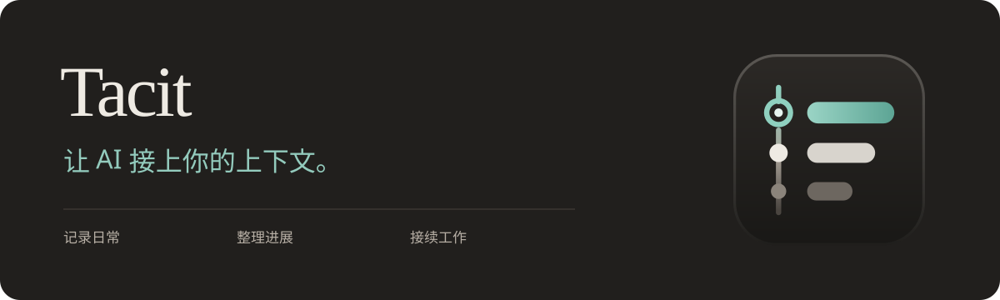

<p align="center">
  
</p>

<p align="center">Mac 上的活动记录，给你回看，也给 AI 接着用。</p>

<p align="center">
  <a href="#开始使用">开始使用</a> ·
  <a href="#连接-ai">连接 AI</a> ·
  <a href="#数据与隐私">数据与隐私</a> ·
  <a href="#开发">开发</a>
</p>

Tacit 用 AI 会话、微信对话和录音整理每天的进展与决定，结论可以点回原文。屏幕和浏览器提供应用、标题和时长，采集的文字仍可搜索。你可以在 Mac 看每日回顾，也可以让 Claude Code 或 Codex 查询项目进展。

> **开发预览**：当前主线是 Apple 芯片 Mac 版本，目标系统为 macOS 14 及以上。已在开发机安装试用，全天资源占用、记录准确率和更多系统环境仍在验收。暂不提供经过公证的安装包。

## 从一天的活动，到能接着用的上下文

| 你想做什么 | Tacit 怎么帮忙 |
| --- | --- |
| 找回刚才看到的东西 | 搜索历史文字，按日期、来源或设备筛选，展开查看原始记录。 |
| 想起一件事做到哪里 | “此刻”展示正在推进的事项和项目进展，详细记录可以展开依据。 |
| 换一个 AI 继续工作 | 让 AI 主动查询历史；Claude Code 和 Codex 新会话还可带入当前项目摘要。 |
| 留下会议或聊天内容 | 在本机转写录音，按场查看总结和原文，标注说话人。 |
| 改正误解或删掉记录 | 补写、修正事实，或把不相关的内容移出事项；删除后立即撤下受影响的旧摘要。 |

屏幕截图只在内存里用于识字，不保存截图。原始音频单独加密保存，默认保留 7 天；History 保留的是文字。

## 开始使用

需要 Apple 芯片 Mac、完整的 Xcode（Swift 6 及以上，含 `actool`）和 [Bun](https://bun.sh)。首次打开 Xcode 完成组件安装，仅安装 Command Line Tools 不足以覆盖应用资源编译。

```sh
git clone https://github.com/JinSooo/tacit.git
cd tacit
bun install --frozen-lockfile
./install.sh
```

仓库为私有时，克隆需要有访问权限的 GitHub 账号。首次安装会下载并校验语音模型与推理库，然后构建、自签名应用，并安装本机后台服务。安装过程需要 Python 3；运行记录整理还需要可用的模型服务。

1. 从菜单栏打开 Tacit，在“回顾”的准备清单里完成系统授权。
2. 在 **设置 › AI 模型** 选择整理所用的模型，并测试连接。全新配置默认使用本机已登录的 Claude Code，也可以改用 Codex 或 API。
3. 在 **设置 › 数据源** 选择要记录的来源。需要记录微信对话时，在此开启并授权。
4. 在 **设置 › AI 工具** 连接你使用的工具，再到 **维护 › 密钥备份** 保存密钥备份。

常规整理每 15 分钟运行一轮。模型调用会消耗你的 API 额度或账号用量；费用取决于活动量、历史导入和所选模型。

## 连接 AI

| 工具 | 主动查询历史 | 新会话带入项目摘要 |
| --- | :---: | :---: |
| Claude Code | ✓ | ✓ |
| Codex | ✓ | ✓ |

连接后可以这样问：

> 昨天下午我主要在做什么？
>
> 这个项目上次确定了哪些事，还有什么没完成？
>
> 把这次讨论的结论补写进历史记录。

这些是提问示例，回答取决于实际采集的内容与整理结果。AI 默认以读取为主，每次读取留审计；追加 History 需要你明确要求。

整理模型与查询工具可以分别选择。支持 Anthropic、OpenAI 兼容 API、自定义服务地址，以及本机已登录的 Claude Code / Codex。

## 数据与隐私

**数据保存在本机，不等于数据永不离开本机。** 选择云端模型整理时，相关文字会交给你配置的模型提供方；AI 工具主动读取后，也会在该工具的会话中使用。Tacit 不收集遥测，不提供集中托管服务。

- **本机存储**：数据库、原始音频、音频元数据和待发送记录加密保存；密钥保存在 macOS 钥匙串。丢失密钥后无法恢复内容。

- **录音**：本仓库 Mac 版本在本机转写。未标出“我”前不转写；标出后，对话含你的声音或满足会议例外才转写。转写文字是否交给云端，取决于后续整理与 AI 查询。

- **屏幕读取**：黑名单排除密码管理器等应用；隐私窗口依赖标题识别，部分浏览器或语言可能漏判，处理私密内容前请暂停记录。

- **密钥拦截**：写入前拦截已知格式的凭据，无法识别所有密码或未知秘密格式。终端钩子的明文缓冲是例外，成功入库后删除。

- **私密记录**：`private` 默认不参加模型整理，也不自动带入；可选择仅允许本地模型整理。AI 主动查询仍能读到，它不是查询权限隔离。

- **网络与插件**：后台仅监听本机。第三方数据源只能读取确认过的范围，禁止联网、写文件和启动子进程；隔离工具不可用时拒绝执行。

内置过滤规则不占用隐私设置页：屏幕采集跳过 Apple 密码、钥匙串访问、1Password、Bitwarden、LastPass、Dashlane 和 Proton Pass；剪贴板跳过带隐藏、临时或自动生成标记的内容；文件监听跳过隐藏目录和密码管理器目录。浏览器隐私窗口按标题识别，无法覆盖所有浏览器和语言。当前没有自定义应用排除入口。

原始音频默认保留 7 天，可直接填写 1–365 天，也可选择“不自动清除”；后者会持续占用磁盘，手动清理仍可用。保留期不删除转写文字、事项和日记。

数据默认在 `~/Library/Application Support/record-anything/`，不随源码上传。请不要在 Issue、日志附件或截图中附上历史正文、密钥、音频及其他人的隐私内容。

## 当前边界

- 新装和升级时关闭 Git、终端命令、文件、剪贴板采集。这些来源的已有记录可在 Mac 或通过 MCP 搜索。
- Mac 设置收起第三方插件安装、本机整理模型和 Claude Desktop 的入口。网页用于查看后台状态。
- 此仓库主线交付 Mac 采集端与本机后台；Android、多设备配对和同步不包含在本次主线交付中。
- 全文记录和 AI 总结可能遗漏或理解错误，重要结论应核对依据；全天性能与准确率尚未完成长期验收。
- 开发机关闭了 SIP，文件类权限仍需在 SIP 开启的设备上验证；第三方隔离依赖当前 macOS 的 `sandbox-exec`，未来系统兼容性待验证。
- 原生浅色、最小窗口和完整弹窗矩阵还没有全部验收；云端转写属于后续规划，当前 Mac 转写走本地引擎。

## 更新与卸载

```sh
# 更新源码并重新安装，保留已有数据与设置
git pull --ff-only
./install.sh

# 卸载时会询问是否一并删除数据
./uninstall.sh
```

扩展数据源从 **设置 › 数据源 › 安装数据源** 添加，支持本地目录或 Git 地址。预览读取范围与配置后安装，默认停用。示例与清单格式见 [插件开发说明](docs/plugins.md)。

## 开发

| 目录 | 内容 |
| --- | --- |
| `collector/` | Swift / SwiftUI 菜单栏应用、采集、录音与本地转写 |
| `hub/` | Bun 后台、加密数据库、整理任务和 AI 接口 |
| `web/` | React 网页备用入口 |
| `plugins/`、`schema/` | 内置数据源、记录契约与跨端测试样例 |

在仓库根目录运行：

```sh
bun test
bun x tsc --noEmit
bun x vite build --config web/vite.config.ts

# 需要先准备安装脚本下载的本机音频库
python3 scripts/guarded-run.py --memory-mb 3072 --seconds 240 -- collector/swift.sh test -j 2
./scripts/export-icons.sh --check
```

测试使用合成记录和临时数据目录。安装脚本会修改本机安装与服务，不要把 `./install.sh` 当成无副作用的测试命令。

[设计与验收](docs/design.md) · [安装细节](docs/installation.md) · [接口契约](docs/contracts.md) · [界面规范](docs/ui.md) · [性能采样](scripts/performance-sampling.md)

## 许可证

本仓库代码采用 [MIT License](LICENSE)。第三方依赖、字体及下载的模型遵循各自许可证；内置 Phosphor 字体的许可证保留在 [资源目录](collector/Resources/Phosphor/LICENSE)。
